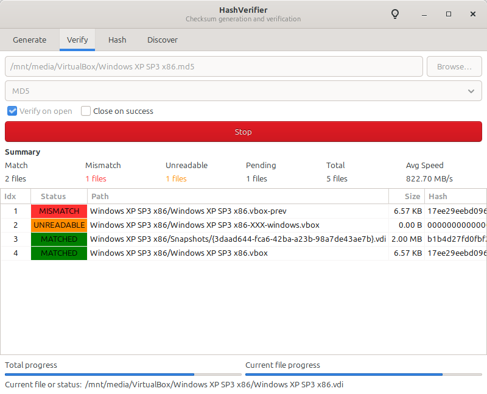

# HashVerifier

A cross-platform checksum generation and verification tool with both CLI and GTK3 graphical interface.



## Features

- **Checksum Generation** — Recursively generate checksum files for entire directories
- **File Verification** — Verify files against existing checksum files
- **File Hashing** — Hash individual files with one or more algorithms and optional export
- **Multiple Algorithms** — Support for 13 hash algorithms
- **Dual Interface** — Use via command-line or intuitive GUI
- **Progress Tracking** — Live progress in the GUI for every operation; per-file status lines in the CLI
- **Speed Tracking** — Live hashing speed in the GUI for directory scans and verification
- **Symbolic Link Support** — Walks symbolic links (including NTFS junctions)
- **Embedded Checksums** — Discover, verify, add, fix, or remove CRC-32 checksums in file names
- **UTF-8 Encoding** — All checksum files are saved in UTF-8 encoding
- **Persistent Settings** — GUI preferences and column order are saved automatically

## Supported Platforms

| Operating System | Architecture | Package |
|------------------|--------------|---------|
| Linux | x86_64 (amd64) | DEB, RPM, AppImage, Flatpak |
| Linux | ARM64 (aarch64) | DEB, RPM, AppImage, Flatpak |
| Linux | x86 (i386/i686) | DEB, RPM |
| Windows | x86_64 (amd64) | ZIP, EXE Installer |
| Windows | x86 (i686) | ZIP, EXE Installer |
| macOS | Apple Silicon (arm64) | DMG |
| macOS | Intel (x86_64) | DMG |

**Recommended installation:** Flatpak is the recommended installation method for Linux as it provides automatic updates and includes all dependencies.

**Minimum OS versions:**

- **Linux:** Ubuntu 20.04+, Fedora 32+, Debian 11+, RHEL 9+ (GLIBC 2.31+, GTK 3.24+)
- **macOS:** Monterey 12.0 or later (Apple Silicon or Intel)
- **Windows:** Windows 7 SP1 and later (32-bit and 64-bit)

> **Note for Flatpak:** Minimum requirements depend on the Flatpak runtime version.

> **Note for Linux x86:** The 32-bit package is available as DEB (`i386`) and RPM (`i686`) only; AppImage and Flatpak are not built for this architecture. On a 64-bit Debian/Ubuntu system, enable the i386 architecture first with `sudo dpkg --add-architecture i386`.

> **Note for Windows:** Windows binaries run in GUI mode only (no CLI support).

## Supported Hash Algorithms

| Algorithm | Extension | Format |
|-----------|-----------|--------|
| CRC32 | `.sfv` | `filename hash` |
| MD4 | `.md4` | `hash *filename` |
| MD5 | `.md5` | `hash *filename` |
| SHA1 | `.sha1` | `hash *filename` |
| SHA256 | `.sha256` | `hash *filename` |
| SHA384 | `.sha384` | `hash *filename` |
| SHA512 | `.sha512` | `hash *filename` |
| SHA3-256 | `.sha3-256` | `hash *filename` |
| SHA3-384 | `.sha3-384` | `hash *filename` |
| SHA3-512 | `.sha3-512` | `hash *filename` |
| BLAKE3 | `.blake3` | `hash *filename` |
| XXH3 | `.xxh3` | `hash *filename` |
| XXH128 | `.xxh128` | `hash *filename` |

## Installation

### Linux

**Flatpak (Recommended):**

```bash
flatpak install flathub io.github.ostapkonst.HashVerifier
flatpak run io.github.ostapkonst.HashVerifier
```

> **Flatpak Sandbox Notice:** The Flathub store build is sandboxed: by default, only the **Documents**, **Desktop**, and **Downloads** folders are accessible — use [Flatseal](https://github.com/tchx84/Flatseal) to grant additional permissions. A package built locally from this repository (`make flatpak`) instead grants **full host filesystem access** (`--filesystem=host`), since reading arbitrary files is the application's core task.

**DEB (Debian/Ubuntu):**

```bash
sudo apt install ./hashverifier_X.X.X_amd64.deb        # ARM64: ..._arm64.deb, x86: ..._i386.deb
```

**RPM (Fedora/RHEL):**

```bash
sudo dnf install ./hashverifier-X.X.X-1.x86_64.rpm     # ARM64: ...-1.aarch64.rpm, x86: ...-1.i686.rpm
```

**AppImage (Universal Linux):**

```bash
chmod +x HashVerifier-X.X.X-x86_64.AppImage           # ARM64: HashVerifier-X.X.X-aarch64.AppImage
./HashVerifier-X.X.X-x86_64.AppImage
```

### Windows

**Installer (Recommended):**

Download and run the installer for your architecture:

- `hashverifier-X.X.X-windows-amd64.exe` (64-bit)
- `hashverifier-X.X.X-windows-i686.exe` (32-bit)

Setup offers **All users** (requires UAC; installs to `%ProgramFiles%`) or **Only for me**
(no admin rights; installs to `%LocalAppData%\Programs\HashVerifier`). Both modes create
shortcuts and checksum file associations. Upgrades keep the chosen mode; to switch modes
or architectures, uninstall first. For silent installs, use `/CURRENTUSER` or `/ALLUSERS`
(default: current user).

**Portable ZIP:**

Download and extract the ZIP archive for your architecture. The portable build needs no
administrative privileges and does not create shortcuts or file associations:

- `hashverifier-X.X.X-windows-amd64.zip` (64-bit)
- `hashverifier-X.X.X-windows-i686.zip` (32-bit)

### macOS

Download the DMG for your architecture:

- `hashverifier-X.X.X-macos-arm64.dmg` (Apple Silicon)
- `hashverifier-X.X.X-macos-amd64.dmg` (Intel)

Open the DMG and drag `HashVerifier.app` to **Applications**. The app is self-contained (GTK3 is bundled) and registers file associations with icons for all supported checksum formats.

> Prebuilt binaries are unsigned; first launch requires manual approval (right-click → Open, or System Settings → Privacy & Security → Open Anyway). If the launch is still blocked, remove the quarantine attribute: `xattr -dr com.apple.quarantine /Applications/HashVerifier.app`.

## Usage

See [Usage Guide](docs/USAGE.md) for detailed documentation on GUI mode, CLI commands, configuration, and output formats.

## Build from Source

See [Development Guide](docs/DEVELOPMENT.md) for build instructions and contribution guidelines.

## Related Projects

HashVerifier was inspired by:

- [HashCheck Shell Extension](https://github.com/gurnec/HashCheck)
- [HashCheck Fork](https://github.com/idrassi/HashCheck)

Unlike these Windows-only tools, HashVerifier is cross-platform.

## License

MIT License — see [LICENSE](LICENSE). Third-party notices in [THIRD_PARTY_NOTICES](THIRD_PARTY_NOTICES).
